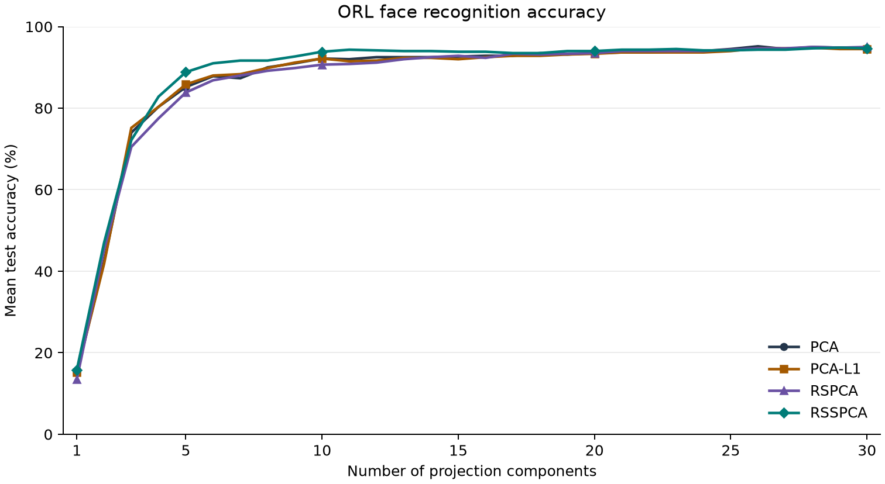

# Robust Sparse Smooth PCA for face recognition

## How AI found the algorithm

I asked Codex to find a recent PCA or LDA method for a computer vision task and propose a reproducible experiment before implementing it. Codex searched for recent methods using combinations of `robust PCA`, `2DPCA`, `sparse LDA`, `face recognition`, and `image classification`. The shortlist included a 2024 robust sparse LDA paper, a 2025 weighted two-dimensional PCA paper, and the 2025 Robust Sparse Smooth PCA (RSSPCA) paper by Wang et al. Codex selected RSSPCA because the paper specified an iterative solver and a classification protocol, and the authors made both their reference scripts and benchmark matrix available. [Robust sparse LDA paper](https://doi.org/10.1016/j.patcog.2024.110512) · [Double Layer Robust 2DPCA paper](https://doi.org/10.1109/TCE.2025.3602258) · [RSSPCA paper](https://doi.org/10.1371/journal.pone.0323281) · [Authors’ research repository](https://github.com/yuzhounh/RSSPCA)

## Algorithm

Ordinary PCA chooses unit directions that maximize the sum of squared projections. PCA-L1 uses the sum of absolute projections, which reduces the relative influence of large projections. RSSPCA adds two constraints. A sparsity constraint favors directions with many small or zero pixel weights. A smoothness constraint penalizes differences between the weights of neighboring pixels. The method uses labels only in the downstream classification experiment. [Wang et al., sections 2–3](https://doi.org/10.1371/journal.pone.0323281)

Let $X\in\mathbb{R}^{d\times n}$ contain centered training images as columns and $w\in\mathbb{R}^d$ be a projection direction. For RSSPCA’s first direction, the paper gives the objective and constraints

$$
\max_w\ \lVert X^\top w\rVert_1,
\qquad \lVert w\rVert_2=1,\quad \lVert w\rVert_1\le c_1,\quad w^\top Lw\le c_2.
$$

Here $L$ is the graph Laplacian of the image grid. Its quadratic form is the sum of squared differences $(w_i-w_j)^2$ across horizontal and vertical neighbor pairs. For an iterate $w$, the minorization–maximization procedure sets $D=\operatorname{diag}(|w|)$ and $v=X\operatorname{sign}(X^\top w)$. It solves the following system and normalizes the result to obtain the new direction. The parameters $\eta_1$ and $\eta_2$ control sparsity and smoothness. [Wang et al., equations 13 and 30–33](https://doi.org/10.1371/journal.pone.0323281)

$$
(D+\eta_1 I+\eta_2 DL)u=Dv,\qquad w_{\mathrm{new}}=u/\lVert u\rVert_2.
$$

Setting both penalties to zero gives PCA-L1, whose update normalizes $v$ directly. Setting only $\eta_2$ to zero gives Robust Sparse PCA (RSPCA). After each fitted direction, Algorithm 1 updates the residual training matrix by premultiplying it by $I-WW^\top$, with the fitted directions as columns of $W$. [Wang et al., Algorithm 1](https://doi.org/10.1371/journal.pone.0323281)

## How AI implemented and checked it

Codex implemented Algorithm 1 in Python with NumPy and SciPy. The code uses an SVD of the standardized training matrix to initialize each direction. It then repeats the reweighted update until the relative change in $\lVert X^\top w\rVert_1$ is at most $10^{-4}$ or the iteration count reaches 100. The L1 statistic follows the paper, while the public MATLAB solver uses the L2 norm for its stopping statistic. [Published algorithm](https://doi.org/10.1371/journal.pone.0323281) · [Reference MATLAB solver](https://github.com/yuzhounh/RSSPCA/blob/main/RSSPCA.m)

For positive sparsity and smoothness weights, Codex rewrote the update using $S=\sqrt{D}$. It solves $(D+\eta_1 I+\eta_2 SLS)z=Sv$ and sets $u=Sz$. Multiplying the first system by $S$ on the right gives this equivalent symmetric form, which uses sparse storage and avoids division by a zero loading. The solver applies deflation through products with the narrow matrix $W$ to avoid constructing a dense $d\times d$ matrix. The checks validate pixel adjacency, compare the sparse solve against the original equation with exact zero weights, and verify the zero-penalty PCA-L1 update. [Python solver](rsspca.py) · [Solver checks](tests/test_rsspca.py)

## Experiment setup

The ORL matrix contains 400 grayscale images of 40 subjects with ten images each. The authors’ 56 × 46 resized images give 2,576 pixel features per image. The task is to identify a subject from a held-out image when other images of that subject occurred in training. The published protocol specifies per-subject splits and pixelwise z-score normalization. The public MATLAB classification script uses a global split and mean subtraction, so Codex used the paper’s written protocol as the reference for the experiment. [Paper, section 4](https://doi.org/10.1371/journal.pone.0323281) · [Reference classification script](https://github.com/yuzhounh/RSSPCA/blob/main/classify_RSSPCA.m) · [Benchmark dataset](https://doi.org/10.6084/m9.figshare.27643026)

The outer split assigned seven images per subject to training and three to testing, for 280 training and 120 test images per split. Five fixed seeds (11, 23, 37, 53, and 71) produced shared splits for all methods. For penalty selection, a separate split inside each outer training set used five images per subject for fitting and two for validation. At each stage, Codex computed the pixel means and sample standard deviations from the corresponding fit partition and reused them for the validation or test images.

For RSSPCA, Codex evaluated the nine combinations of $\eta_1\in\{0.01,0.10,0.25\}$ and $\eta_2\in\{0.1,10,100\}$. RSPCA used the same sparsity grid with $\eta_2=0$. For each method requiring tuning, Codex chose one penalty setting per split using the highest validation accuracy averaged over 1–30 components. It then refit on all seven training images per subject. For every method and component count from 1 through 30, the classifier used the label of the closest projected training image by Euclidean distance. The code ran on CPU in Python 3.14.10. [Experiment script](experiment.py)

## Results and interpretation

The table gives mean test accuracy ± sample standard deviation across five splits, expressed in percent. In the rightmost column, each split contributes its mean accuracy across all 30 component counts.

| Method | 1 component | 5 components | 10 components | 20 components | 30 components | Mean over 1–30 |
| --- | ---: | ---: | ---: | ---: | ---: | ---: |
| PCA | 15.17 ± 3.03 | 85.17 ± 1.90 | 92.17 ± 2.09 | 93.50 ± 2.46 | 94.83 ± 2.53 | 87.24 ± 1.86 |
| PCA-L1 | 15.17 ± 1.90 | 85.83 ± 2.12 | 92.17 ± 2.01 | 93.33 ± 2.70 | 94.50 ± 3.36 | 87.14 ± 2.10 |
| RSPCA | 13.50 ± 2.46 | 83.83 ± 6.52 | 90.67 ± 2.60 | 93.50 ± 2.46 | 95.00 ± 2.70 | 86.82 ± 2.05 |
| RSSPCA | 15.83 ± 4.00 | 88.83 ± 3.47 | 93.83 ± 2.67 | 94.00 ± 2.73 | 94.67 ± 2.61 | 88.37 ± 2.17 |

*Figure 1. Mean test accuracy across five shared splits at each component count.*

RSSPCA had the highest accuracy averaged over 1–30 components. The paired gain over PCA on this average was 1.12 percentage points, with seed-level gains from 0.39 to 1.97 points. At five components RSSPCA reached 88.83%, a 3.00-point gain over PCA-L1, the strongest baseline at that dimension. At 30 components, all four methods were within half a percentage point of one another and RSPCA had the highest mean. [Per-split scores and aggregate statistics](results/results.json)

RSSPCA scored 1.54 points higher than RSPCA on the average across component counts. Each method’s penalties were tuned independently. RSSPCA selected a smoothness weight of 10 in two splits and 100 in three. In the final fits, one RSSPCA direction and one RSPCA direction stopped at the 100-iteration cap before reaching the tolerance. Both fits used their last iterates. [Penalty and convergence diagnostics](results/results.json)

The results suggest that this RSSPCA implementation is most useful when the feature budget is small. The evidence comes from one closed-set benchmark and a limited penalty grid. The five random splits share images across repetitions, so the reported standard deviations describe split-to-split variation. The experiment used the supplied images without added corruption. A separate corruption experiment would be needed to assess resistance to occlusion or noise. The paper’s reported ORL accuracy averaged over 1–30 components was 88.10%, under its own repetitions and penalty sweep. [Wang et al., section 4.2 and Table 2](https://doi.org/10.1371/journal.pone.0323281)

## Reference

Wang, J., Xie, X., Zhang, L., Li, J., Cai, H., & Feng, Y. (2025). Robust sparse smooth principal component analysis for face reconstruction and recognition. *PLOS ONE*, 20(5), e0323281. [DOI](https://doi.org/10.1371/journal.pone.0323281)

## What I learned

## Source code URL
